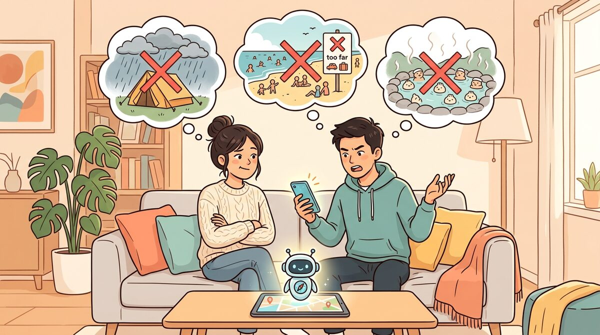
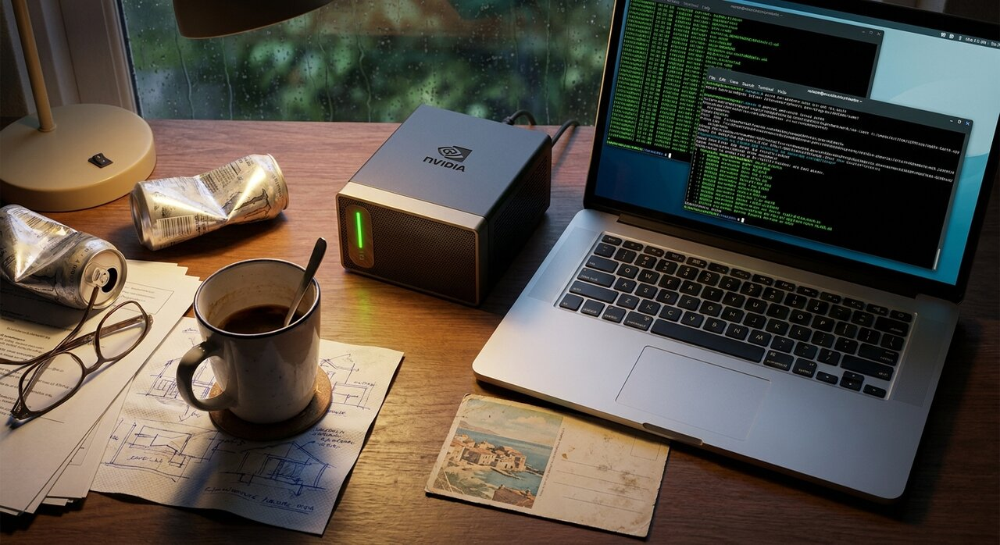

# NemoClaw Travel OS：基于 NVIDIA DGX Spark 构建可工程化的私有化家庭 AI

> NVIDIA Inception Success Story · 2026-04
> 提交方：「交个朋友」团队 / 深圳市机甲之灵科技有限公司  团队

---

## 一、案例简介 / Case Introduction

### 中文（约 50 字）

- 本案例中，「交个朋友」 团队基于 **NVIDIA DGX Spark + NVFP4 原生精度**，**为自家**构建了在客厅运行 1200 亿参数大模型的私有化 AI 旅行助手 **NemoClaw Travel OS**——客户即团队本身，自研自用并开源给社区。
- 本案例主要应用 **NVIDIA DGX Spark（GB10 Grace Blackwell）**、**NemoClaw 安全 AI 沙箱** 和 **NVFP4 量化精度**。

### English

- In this case, the "Be Friends" team built **NemoClaw Travel OS** **for their own household** — a private family AI travel assistant running 120-billion-parameter LLMs on living-room GPU hardware with zero cloud dependency — on **NVIDIA DGX Spark** with native **NVFP4** precision. The team is both the developer and the first customer; the entire stack is open-sourced to the community.
- The major NVIDIA products utilized are **NVIDIA DGX Spark (GB10 Grace Blackwell Superchip)**, the **NemoClaw safe-sandbox**, and **NVFP4 quantization**.


---

## 二、客户简介及应用背景

> **本案例的客户即团队自身**——「交个朋友」是一个基于 OPC（One Person Company）范式的实践型团队，通过家庭服务器集群构建系统，**用 NVIDIA DGX Spark 解决的是自家真实生活场景中的痛点**，整套方案先服务自己、再开源共享。这是 NVIDIA Inception 中较为典型的"自研自用 + 开源共享"模式。


故事的起点不是市场调研，而是 **2026 年清明假期前两周家里的一段真实对话**：

> 「去汕尾？」「单程三小时，三天假光在路上。」
> 「露营？」「台风外围，三天都下雨。」
> 「惠州？」「去过七八次了。」
> 「那你说去哪？」「……算了待家里吧。」

每到节假日都会上演的"去哪"剧本，是这个家庭催生 NemoClaw Travel OS 的真正起点。团队成员之间需要的不是又一个云端旅行 App——**自家行程、家庭住址、消费习惯、餐厅偏好都属于不愿外传的隐私**——而是一个跑在自家客厅、按家人偏好定制、长期共同使用的私有 AI 旅行规划助手。



但要把这件事做成，自家面对的工程难题非常具体：

- 真正能"听懂老婆说什么、规划老公能接受的行程"的模型至少需要百亿参数级别——这在 DGX Spark 之前根本跑不进客厅
- 家里同时有 3 个家庭账号在用、还要和飞书 / 小红书 / 高德地图打通，单卡显存装一个模型就满了
- 家里的家庭网络出口、家庭 NAS、家庭路由要无缝串起来，没人愿意天天手工运维

**NVIDIA DGX Spark 把消费级 AI 算力的门槛拉到了客厅高度**——128GB 统一内存 + GB10 Grace Blackwell Superchip + 原生 NVFP4 精度，让 1200 亿参数级别的模型第一次可以在自家客厅以对话速度运行。基于这台金盒子，「交个朋友」团队在 **NVIDIA DGX Spark Hackathon 2026** 中构建了 NemoClaw Travel OS，先在自家三个家庭账号实测跑通，并在全国赛中取得**第六名**——同样有"家庭私有 AI"需求的 Homelab 玩家可以基于开源仓库直接复现。

---

## 三、客户挑战

「交个朋友」团队作为 NemoClaw Travel OS 的客户和第一批使用者，在自家场景中遇到了 5 个相互嵌套的真实挑战：

1. **自家隐私不能上云**——夫妻两人的行程偏好、家庭住址、消费习惯、餐厅口味、孩子和父母的出行参与度都是高度敏感的家庭信息。传统旅行 App 和云端大模型 API 全部要求把这些数据上传到第三方服务器——这是这对夫妻无法接受的前提。

2. **家里要装的模型不止一个**——一个真正"能听懂老婆挑剔需求"的旅行助手需要至少百亿参数级别的主对话模型（云希），加上一个能看照片归档、提取攻略截图的多模态视觉模型，再加一个低延迟应答用的小模型。**自家原本的 RTX 级消费 GPU 单卡显存只够塞一个模型**，无法满足家庭场景的真实多任务需求。

3. **家里 3 个家庭账号要并发用**——丈夫、妻子、共用账号——同时在飞书规划行程、用小红书 Skill 生成种草文案、用 Gemma 4 分析旅行照片。任何一次"模型在排队、对话变慢"都会让家人立刻放弃用这个工具。

4. **家庭网络栈复杂度爆炸**——把 DGX Spark 接进家里的网络栈涉及：加密隧道连回家庭路由、家庭 NAS 用作长期存储、域名反代到飞书 / 小红书 / 高德地图、Docker 镜像缓存（家里到海外仓库的网络出口受限）、TLS 拦截重签、K3s 多模型服务、NodePort 转发……整个清明假期被 9 个不同层次的运维难点挨个轮番暴打。



5. **"自家可用"远高于"demo 可跑"**——绝大多数 NVIDIA 硬件 demo 停留在"模型能跑"。但要做到**老婆愿意主动用、自家持续使用**，中间需要至少十倍的工程量：从一键部署、自动重启、健康监测、数据备份到家庭日常的可持续运维——这是把"硬件演示"变成"自家长期生产工具"必须迈过的坎。

---

## 四、应用方案

「交个朋友」团队为自家构建 NemoClaw Travel OS 时，**直接采用 NVIDIA DGX Spark 硬件 + NVIDIA 官方 [build.nvidia.com/spark](https://build.nvidia.com/spark) Playbook 栈作为基础**，再叠加自研工程化层完成最后一公里。整个解决方案的层次结构如下：

### 4.1 硬件平台：NVIDIA DGX Spark


| 配置   | 规格                                                |
| ---- | ------------------------------------------------- |
| 超级芯片 | **GB10 Grace Blackwell Superchip**                |
| 统一内存 | **128GB**（CPU + GPU 共享，单一地址空间）                    |
| 原生精度 | **NVFP4**（Blackwell 架构硬件级加速，非软件压缩）                |
| 形态   | 桌面级，无需机房，可放客厅                         |
| 软件栈  | Ubuntu 24.04 ARM64 + NVIDIA 驱动 + containerd + K3s |


### 4.2 多模型同台并发推理（核心技术亮点）

DGX Spark 的 **128GB 统一内存**让 NemoClaw Travel OS 实现了一项以往只能在数据中心做到的事——**单台桌面级硬件同时为多个不同任务的大模型提供 OpenAI 兼容 API 服务**。


| 模型                                 | 参数规模   | 量化               | GPU 内存 | 推理引擎   | 角色       |
| ---------------------------------- | ------ | ---------------- | ------ | ------ | -------- |
| **gpt-oss:120b-fast**（Nemotron 兼容） | 116.8B | MXFP4            | ~66GB  | Ollama | 主对话与行程规划 |
| **Gemma-4-31B-IT-NVFP4**           | 31B    | **NVFP4 (W4A4)** | ~31GB  | vLLM   | 多模态视觉理解  |
| **gpt-oss:20b**                    | 20B    | MXFP4            | ~12GB  | Ollama | 低延迟实时反馈  |


**实测数据对比：**


| 指标                                                     | 传统消费级方案          | DGX Spark + NemoClaw 方案    | 改进                |
| ------------------------------------------------------ | ---------------- | -------------------------- | ----------------- |
| 同时承载的百亿级模型数                                            | **1 个**（单卡显存即上限） | **2 个 + 1 个 20B 共存**       | **3×**            |
| 1200 亿参数模型本地首 token 延迟（默认开启 reasoning）                 | /                | ~20s                       | 基线                |
| 1200 亿参数模型首 token 延迟（`gpt-oss:120b-fast`，关闭 reasoning） | /                | **< 2s**                   | **~10× 用户感知响应速度** |
| 32K 上下文窗口下持续对话稳定性                                      | 不可用              | **稳定**                     | 落地                |
| 模型冷启动（默认 keep_alive 5 分钟过期重载）                          | ~20s+ 冷加载        | `**keep_alive=-1` 常驻 GPU** | 接近零冷启动            |
| 视觉模型量化精度                                               | INT4（精度有损）       | **NVFP4 硬件原生**             | Blackwell 原生加速    |


### 4.3 NemoClaw 安全沙箱 + OpenShell

NemoClaw 是 NVIDIA 官方为 DGX Spark 提供的**安全 AI 助手沙箱**，基于 K3s + OpenShell 提供 Linux 命名空间级别的工具调用隔离。「交个朋友」团队的 OpenClaw 多智能体框架（**云希** - INFJ 处女座旅行规划师人格）就跑在 NemoClaw 沙箱之上：所有模型工具调用、文件读写、外部 API 通讯都被沙箱沿 OpenShell-proxy 强制 TLS 拦截重签——**安全性达到企业级标准的同时不牺牲开发速度**。

> NemoClaw 是 [build.nvidia.com/spark](https://build.nvidia.com/spark) 上 "First Time Here?" 区域第一位推荐入门项目，本案例即基于其官方 Playbook 改造扩展。

### 4.4 一键部署：Ansible Playbook

「交个朋友」团队把整套从内核到应用的复杂度封装到**一条 Ansible 命令**：

```bash
ansible-playbook playbooks/nemoclaw/site.yml
```

**这条命令负责：**

- 安装 Ollama 并下拉 `gpt-oss:120b-fast`
- 部署 NemoClaw + OpenShell 沙箱
- 启动 vLLM + Gemma 4 NVFP4
- 部署 Travel App（Express + SQLite + 高德地图 MCP）
- 配置加密隧道与 DNAT 规则
- 配置 Docker 镜像缓存（解决海外仓库出口受限）
- 设置自动更新与健康监测

**部署效率对比：**


| 阶段                   | 时间                   | 说明                                                  |
| -------------------- | -------------------- | --------------------------------------------------- |
| 黑客松前手工部署（9 个生产级运维难点） | ~ **3 整天**（清明假期全部投入） | 容器、加密隧道、TLS 拦截重签、注册表镜像、多模型并存逐项调通                    |
| Ansible 化后再次部署       | ~ **2 分钟**           | `curl https://nemoclaw.peafamily.online/` → **200** |
| 工程效率提升               | **~1000×**           | 把 9 次踩坑沉淀为一条命令                                      |


---

## 五、使用效果及影响

### 5.1 自家实测成果

- **自家清明假期"去哪"的剧本第一次有了答案**——云希（NemoClaw 上的旅行人格）在 3 分钟内给出了深圳到汕尾的三天两夜完整行程，包括天气交叉验证、4 月 17–19 日台风外围风险评估、本地生腌餐厅高德评分筛选、刮刮乐集章卡和每日攻略。这是夫妻 N 次"算了待家里吧"之后第一次得到一份双方都满意的方案。


- **3 个家庭账号同时挂机一周无降速**：自家测试阶段，丈夫账号在飞书让云希规划行程、妻子账号在小红书 Skill 写种草文案、共用账号让 Gemma 4 NVFP4 视觉模型批量整理旅行照片——三路并发持续整周，**没有任何一个查询变慢**。这是过去单卡消费级 GPU 在自家完全跑不通的体验。
- **自家长期运维成本归零**：第一次手工部署用了清明假期整整 3 天，封装成 Ansible Playbook 后再跑一次 ~2 分钟，自家后续每次升级、回滚、迁移都是一条命令。

### 5.2 行业层面影响

虽然 NemoClaw Travel OS 起源于自家需求，但项目本身在行业层面也获得了 NVIDIA 官方的认可与社区放大：

- **NVIDIA DGX Spark Hackathon 2026 全国赛第六名**——在40多支参赛团队中被 NVIDIA 官方点名进入 TOP 6
- 希望录入**NVIDIA DGX Spark 官方项目案例库**——让同样有"自家私有 AI"需求的 Homelab 玩家可以基于开源仓库直接复现
- **整套从内核到应用的部署 Playbook 完全开源**——为消费级 NVIDIA 硬件的家庭 AI 应用提供了一份可重复执行的工程范式

### 5.3 自家使用者引言

> **「这不是为别人做的产品——这是我们家自己每天在用的工具。清明假期前两周老婆问我"今年去哪"那天，是我决定用这台 NVIDIA DGX Spark 做点什么的开始。**
>
> **128GB 统一内存让我能同时跑两个百亿级模型——一个理解老婆需求，一个看照片整理回忆——这是自家原来 RTX 4090 单卡完全做不到的事。NVFP4 不是简单的压缩，是 Blackwell 架构原生支持的精度，让 1200 亿参数模型在客厅里以对话速度跑。**
>
> **真正让我意识到 DGX Spark 改变了什么的瞬间——是有一天老婆主动问"我们让云希再规划一次端午行程吧"。一个家庭工具被家人主动提起，比任何 benchmark 都说明问题。**
>
> **NVIDIA DGX Spark 没有让我们做出一个新的"AI 旅行 App"——它让我们家有了第一个真正属于自家的 AI 助手。」**
>
> **—— PeterPan，「交个朋友」团队主理人 / NemoClaw Travel OS 共同使用者**
> *NVIDIA Inception 候选会员；OpenClaw 多智能体框架作者；连载《我在家里养了一个 AI 团队》*

---

## 六、NVIDIA 初创加速计划

「交个朋友」团队是 **NVIDIA 初创加速计划（NVIDIA Inception）** 候选会员企业。NVIDIA 初创加速计划为免费会员制，旨在培养颠覆行业格局的优秀创业公司。该计划联合国内外知名的风投机构、创业孵化器、创业加速器、行业合作伙伴以及科技创业媒体等，打造创业加速生态系统，能够提供产品折扣、技术支持、市场宣传、融资对接、业务推荐等一系列服务，加速创业公司的发展。

> 想获得 NVIDIA 初创加速生态助力？扫描 NVIDIA 官方二维码，仅需一分钟填写意向申请表单，获得快速联系。

---

## 七、授权声明

**「交个朋友」团队 **（此处请客户填写公司名字以示确认）同意授权 NVIDIA 可将此案例内容用于市场推广当中，市场推广的渠道包括 NVIDIA 及其合作伙伴的官方网站，微信微博头条等 social 平台，媒体（如客户对媒体渠道有顾虑，可把此项删掉）等。如果对客户案例实质内容有修改，需发给客户进行确认。

---

## 八、合作伙伴信息（用于 NVIDIA 合作伙伴官方渠道推广）

> **关于本案例的特殊性**：本案例为"自研自用 + 开源共享"模式——客户、开发者、合作伙伴在身份上为同一主体（「交个朋友」团队）。团队既是 NVIDIA DGX Spark 的最终使用者，也是 NemoClaw Travel OS 解决方案的提供者。以下"合作伙伴"字段填写同一主体，表述按自研身份呈现。
>
> 以下内容仅用于 NVIDIA 合作伙伴官方渠道推广。

| 字段 | 内容 |
| --- | --- |
| **合作伙伴公司名称** | 深圳市机甲之灵科技有限公司 |
| **合作伙伴公司简介**（约 50 字） | NVIDIA Inception 候选会员，专注于 Homelab + AI Agent 私有化部署的实践型团队，自研 OpenClaw 多智能体框架与 OpenShell 安全沙箱，长期在 NVIDIA GPU 与边缘设备上运行家庭级 AI 自动化生态。 |
| **合作伙伴在此案例中提供的解决方案及发挥的作用**（300 字以内） | 「交个朋友」团队作为 NemoClaw Travel OS 的开发方与第一批使用者（客户即开发者），在 NVIDIA DGX Spark 上以官方 [build.nvidia.com/spark](https://build.nvidia.com/spark) Playbook 为基础，**为自家**完整构建了私有化 AI 旅行操作系统，并将整套方案开源共享给同样有需求的家庭和 Homelab 社区。团队设计了基于 OpenClaw 的多智能体架构（云希——INFJ 处女座旅行规划师人格），编写了完整的 Ansible 一键部署 Playbook，把 9 个生产级运维难点（加密隧道、Docker 镜像缓存、TLS 拦截重签、多模型共存、K3s NodePort 转发、Nginx 域名反代等）沉淀为一条命令；同时基于 NemoClaw 沙箱实现了 5 步式旅行闭环（理解 → 规划 → 出行 → 记录 → 发布），并接入高德地图 MCP 实现真实导航。整个项目首先在自家三个家庭账号实战验证后开源，实证了 DGX Spark 上多个百亿级模型可同台并发服务、NVFP4 原生精度可显著提升多模态推理吞吐、Ansible 化部署可让家庭用户开箱即用，为消费级 NVIDIA 硬件的家庭 AI 应用提供了可复制的工程范式。 |


---

## 附录：开源仓库与参考链接


| 资源                           | 链接                                                                                                                                                 |
| ---------------------------- | -------------------------------------------------------------------------------------------------------------------------------------------------- |
| Ansible Playbook 仓库          | [github.com/peterpanstechland/ansible-dgx-spark](https://github.com/peterpanstechland/ansible-dgx-spark)                                           |
| Travel App + Skill 仓库        | [github.com/peterpanstechland/nemoclaw-travel-planner](https://github.com/peterpanstechland/nemoclaw-travel-planner)                               |
| NVIDIA 官方 DGX Spark Playbook | [build.nvidia.com/spark](https://build.nvidia.com/spark)                                                                                           |
| 项目博客（中文）                     | [peterpanstechland.github.io/zh-Hans/docs/hackathons/2026/nvidia-dgx-spark](https://peterpanstechland.github.io/zh-Hans/docs/hackathons/2026/nvidia-dgx-spark) |
| 项目博客（英文）                     | [peterpanstechland.github.io/docs/hackathons/2026/nvidia-dgx-spark/](https://peterpanstechland.github.io/docs/hackathons/2026/nvidia-dgx-spark/)                 |


---