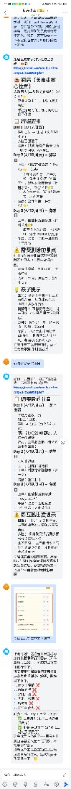
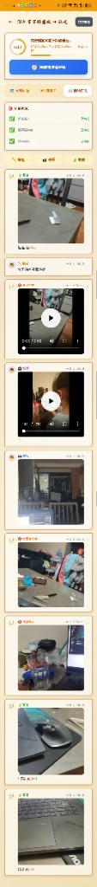

# NemoClaw Travel OS 开箱 NVIDIA DGX Spark：把 1200 亿参数搬进客厅，造一个有灵魂的旅行 AI

> NVIDIA DGX Spark Hackathon 2026（全国赛）· 团队「交个朋友」· NemoClaw Travel OS

---

> 📺 **写在前面的一点意外**
> 在黑客松的线上总结会议上，主办方过排名，名单一行行往下翻——第一名、第二名……翻到第六的时候，我们看到了自己团队的名字。
>
> 当时一瞬间没反应过来。这是几个 Homelab 玩家凑出来的项目，能在全国赛里被点到名，已经远超预期了。
>
> 所以借着这次推文，把这个我们自己也很惊讶的项目—— **NemoClaw Travel OS** ——完整介绍给你。

---

每到节假日，家里都会上演一出经典剧本：「去汕尾？」「太远了。」「露营？」「下雨。」「惠州？」「去过八次了。」「那你说去哪？」「……算了待家里吧。」

我们做了个 AI 帮你解决这个问题。它不在云上，不收订阅费，跑在客厅里那台 NVIDIA DGX Spark 上——一台外形跟 Mac mini 差不多的桌面级超算，统一内存 128GB，原生支持 NVFP4 精度，能让 **Nemotron-3-Super-120B** 这种 1200 亿参数的大模型在你家沙发旁边以对话速度运行。

它叫 **NemoClaw Travel OS**。一个完全私有化的 AI 旅行操作系统。

---

## 一、桌面级超算 + 私有 AI：NVIDIA DGX Spark 重新定义了"在家跑大模型"

NVIDIA DGX Spark 于 2025 年 10 月正式上市。它打破了过去"AI 部署必须依赖云端或大型服务器"的局限，把企业级 GPU 算力压缩进桌面尺寸。

| 规格 | 参数 | 意味着什么 |
|---|---|---|
| **超级芯片** | GB10 Grace Blackwell Superchip | 20 核 ARM CPU + Blackwell GPU，原生 NVFP4 精度 |
| **统一内存** | 128 GB | 1200 亿参数模型完整驻留，零换页 |
| **AI 算力** | 1 petaflop | 单机推理 200B、双机互联推理 405B |
| **形态** | 桌面级 | 一根电源线，安静运行，可 24/7 家用部署 |

**为什么这件事很重要？**

以前想在本地跑 120B 模型，意味着：多 GPU 机架、定制散热、几万块的电费、外加一队运维祈祷集群别过热。现在：一台 DGX Spark，一条 Ansible 命令，搞定。

这是第一次让"家庭私有 AI"从口号变成可工程化的现实。我们这次黑客松要做的，就是验证：**当桌面级超算遇上一个有想法的产品团队，到底能造出什么？**

---

## 二、产品介绍：NemoClaw Travel OS 是什么

NemoClaw Travel OS 不是一个 App，而是一套**完全私有化的 AI 旅行操作系统**——从你说出"我想出去玩"的第一句话，到回来发朋友圈的最后一张图，全链路覆盖，全部数据留在你家的网络里。

### 三大支柱

| 支柱 | 做什么 | 技术支撑 |
|---|---|---|
| **AI 大脑** | 理解你的旅行偏好，规划行程，生成攻略，处理照片 | NemoClaw + Nemotron-3-Super-120B + Gemma 4 NVFP4 |
| **游戏化旅行 App** | 交互式行程，集章打卡，旅行日记，成就系统 | PWA + Express + SQLite + 高德 API |
| **基础设施即代码** | 一条命令部署、升级、回滚全栈 | Ansible + Docker + 加密隧道 |

### 核心 AI 角色：云希

云希（Yún Xī）不是聊天机器人，是一个有人格的旅行伙伴。

> 「'好的！当然可以！很高兴为您服务！'——这些句子我不会说。你问我，我就认真回答。没有内容的废话消耗彼此的时间。」
>
> ——云希，`SOUL.md`

| | |
|---|---|
| **名字** | 云希——「云」云游四方，「希」对未知远方的期待 |
| **MBTI** | INFJ（倡导者）——深度倾听，先懂你再出方案 |
| **星座** | 处女座 ♍——行程精确，但懂得留白给意外之喜 |

云希的人格通过三个 Ansible 部署的配置文件定义——`IDENTITY.md`（她是谁）+ `SOUL.md`（她的原则）+ `TOOLS.md`（她的工作手册）。这意味着她的人格是**版本控制的、可部署的、可升级的**。团队 fork 一份配置，几分钟就能创造一个新人格的旅行伙伴。


---

## 三、部署架构：在 DGX Spark 上构建私有化 AI Agent

整个方案采用四层架构设计，从底层硬件到上层业务应用形成完整闭环：

```
┌──────────────────────────────────────────────┐
│ 业务层：NemoClaw Travel OS                    │
│ 行程规划、集章打卡、旅行日记、小红书种草     │
├──────────────────────────────────────────────┤
│ 应用层：NemoClaw + OpenShell 沙箱             │
│ Skill 隔离执行 + 高德 MCP + Travel App 后端  │
├──────────────────────────────────────────────┤
│ 推理层：本地大模型                           │
│ Nemotron-120B (Ollama) + Gemma 4 NVFP4 (vLLM)│
├──────────────────────────────────────────────┤
│ 硬件层：NVIDIA DGX Spark (GB10 / 128GB)      │
└──────────────────────────────────────────────┘
```

每一层都对应 NVIDIA 官方在 [build.nvidia.com/spark](https://build.nvidia.com/spark) 上推荐的 Playbook。我们的项目就是在 NVIDIA 官方参考栈基础上，构建出的一个完整生产级旅行应用——**NemoClaw 是 build.nvidia.com 上"First Time Here?"第一位的推荐入门项目**。

---

## 四、关键实施步骤

### Step 1 · 环境准备

DGX Spark 默认搭载 Ubuntu Server + 完整 NVIDIA 驱动栈。先安装 NVM + Node 22，确认 Docker 和 GPU 可识别：

```bash
# 安装 NVM 和 Node 22
curl -o- https://raw.githubusercontent.com/nvm-sh/nvm/v0.40.0/install.sh | bash
nvm install 22 && nvm use 22

# 验证 GPU
nvidia-smi
```

### Step 2 · 部署 NemoClaw 沙箱

NemoClaw 是 NVIDIA 官方推出的安全 AI Agent 沙箱框架。一条命令完成 K3s 集群 + 沙箱 Pod + Gateway UI 的部署：

```bash
export NVIDIA_API_KEY='<YOUR_NVIDIA_API_KEY>'
export NEMOCLAW_PROVIDER=build
export NEMOCLAW_SANDBOX_NAME=my-assistant
export CHAT_UI_URL=https://nemoclaw.peafamily.online

nemoclaw onboard --non-interactive
```

部署完成后，浏览器打开 `CHAT_UI_URL` 就能进入 NemoClaw 控制台，沙箱里跑着一个完整的 OpenClaw Agent 框架 + OpenShell 隔离环境。

### Step 3 · 部署本地大模型推理引擎

DGX Spark 原生支持多种推理引擎。我们部署了 **Ollama + vLLM 双引擎组合**，分别承担不同的推理任务。

**Ollama（snap 安装，主力对话模型）：**

```bash
sudo systemctl edit snap.ollama.ollama.service
# 在 override 中添加：
# Environment="OLLAMA_HOST=0.0.0.0:11434"
# Environment="OLLAMA_KEEP_ALIVE=-1"
sudo snap restart ollama

# 拉取并预加载模型（永不卸载，避免冷加载超时）
curl -s http://localhost:11434/api/pull -d '{"model": "gpt-oss:120b"}'
```

**vLLM（OpenAI 兼容 API，多模态视觉模型）：**

```bash
docker run -d --runtime=nvidia --gpus all \
  --name vllm-nvfp4 --network host --shm-size=16g \
  -e VLLM_NVFP4_GEMM_BACKEND=marlin \
  -v /home/xsuper/models/Gemma-4-31B-IT-NVFP4:/models/Gemma-4-31B-IT-NVFP4 \
  vllm/vllm-openai:gemma4-cu130 \
  --model /models/Gemma-4-31B-IT-NVFP4 \
  --served-model-name gemma-4-nvfp4 \
  --port 8888 --max-model-len 32768 \
  --quantization modelopt --gpu-memory-utilization 0.40 \
  --enable-auto-tool-choice --tool-call-parser hermes
```

### Step 4 · 通过 OpenShell 配置推理路由

OpenShell 提供了 `inference.local` 路由能力，让沙箱里的 OpenClaw 不用关心模型在哪：

```bash
# 创建本地 Ollama provider
openshell provider create --gateway nemoclaw \
    --name local-ollama \
    --type openai \
    --credential OPENAI_API_KEY=not-needed \
    --config OPENAI_BASE_URL=http://${MACHINE_IP}:11434/v1

# 把 inference.local 路由到本地 Ollama
openshell inference set --gateway nemoclaw \
    --provider local-ollama \
    --model gpt-oss:120b-fast
```

之后沙箱里所有 LLM 调用都通过 `https://inference.local/v1` 这个虚拟域名，不需要改代码就可以在云端 NVIDIA API 和本地模型之间无缝切换。

### Step 5 · 部署 Travel App + 高德 MCP

```bash
ansible-playbook playbooks/nemoclaw/site.yml
```

这一条 Ansible 命令负责：
- 启动 Travel App（Express + SQLite + 高德 API + PWA 前端）
- 部署高德 MCP Server（让云希用自然语言调用地图 API）
- 配置加密隧道和 DNAT 规则
- 配置 Docker 镜像缓存

升级？改个变量重跑 Playbook。回滚？`git checkout` 上一个版本。加个团队成员？再跑一个 Playbook。

---

## 五、DGX Spark 多模型 A2A 智能编排

不是每个任务都需要同一个模型。NemoClaw Travel OS 通过 **A2A（Agent-to-Agent）协议**，按任务类型和负载智能路由到最优模型：

| 模型 | 运行时 | 强项 | 在 Travel OS 中的用途 |
|---|---|---|---|
| **Nemotron-3-Super-120B** | Ollama | 逻辑推理 + 规划 | 行程生成、多城市路线优化 |
| **Nemotron (TRT-LLM)** | TensorRT-LLM | 高吞吐量 | 家庭成员同时查询 |
| **Gemma 4 31B IT NVFP4** | vLLM | 多模态视觉 | 分析旅行照片、识别标识、描述场景 |
| **GPT-OSS 120B MXFP4** | vLLM | 深度推理 | 复杂多约束行程规划兜底方案 |

**四个模型，全部跑在一台 DGX Spark 上。** 不依赖云端，没有按次计费。

A2A 路由器的核心逻辑很简单：

```javascript
function routeToModel(task) {
  if (task.requiresVision)      return 'http://localhost:18070/v1'; // Gemma 4 vLLM
  if (task.concurrentUsers > 3) return 'http://localhost:18071/v1'; // Nemotron TRT-LLM
  return 'http://localhost:11434/v1';                               // Nemotron Ollama
}
```

一台 DGX Spark 同时承担四种角色：思考者、并发服务、视觉理解、复杂推理兜底。这是黑客松最让人惊讶的发现之一——**128GB 统一内存让"按场景路由"从理论变成了日常**。

---

## 六、应用场景：完整旅行闭环

我们覆盖了从"我想出去玩"到回来发朋友圈的**全链路**——大多数 AI 旅行工具到"给你一个行程"就结束了，云希不一样。

### 💬 第一步：和云希在飞书对话

一切从飞书开始。告诉云希基础信息：

- 出发地和目的地
- 出行方式（自驾、高铁、飞机）
- 参与人数
- 旅行偏好（吃海鲜还是看古迹、预算、必去的地方）

云希理解需求后，自动生成完整行程，推送到前端 [travel-spark.peafamily.online](https://travel-spark.peafamily.online)。

### 🗺️ 第二步：规划

前端网站上看到的是云希生成的完整行程：

- **路线优化**——调用高德驾车/公交 API，返回距离、时长、过路费
- **天气感知排期**——下雨天自动替换为室内备选方案
- **POI 智能推荐**——根据评分、类型和预估游览时长筛选景点和餐厅
- **一键导航**——每个 POI 都带高德 DeepLink，点击直接唤起高德 App



### 🎒 第三步：出行——游戏化的旅途体验

这是 NemoClaw Travel OS 和所有其他旅行工具拉开差距的地方。

- 🎫 **刮刮乐集章打卡**——Canvas 涂层，手指刮开揭晓每天的收集章
- 📍 **LBS 位置签到**——GPS 近场检测区分"亲临现场"和"云打卡"
- 🎁 **盲盒神秘景点**——密封的景点，到达当天才能揭晓
- 🎯 **每日任务**——「今天尝 3 道本地菜」「拍一张日落照片」
- 🏆 **成就徽章**——吃货达人 🍜、摄影高手 📸、探索家、收藏家等 9+ 种
- 🃏 **旅行人格卡**——跨行程分析你的旅行风格（吃货派 / 摄影派 / 冒险派 / 文化派）
- ⭐ **5 级成长体系**——签到、拍照、完成任务获取经验值，跨行程累积


### 📸 第四步：记录

旅行回来，所有照片自动归档到家里的 NAS：

- **明信片风格封面**——每趟旅行自动生成
- **足迹回放动画**——在地图上看你的旅程轨迹
- **瀑布流照片墙**——上传的照片按天和地点自动归类
- **Canvas 分享海报**——长按生成一张可分享的旅行卡片

### 📱 第五步：发布

云希把日记变成可发布的内容：

- **小红书 Skill**——生成符合小红书风格的种草文案，自带 emoji、话题标签
- **Chrome CDP 辅助**——通过 Chrome DevTools Protocol 搜索网上已有的旅行帖子，参考真实用户经验提升推荐质量
- **NAS 归档**——所有照片、视频、日记永久归档到你家的 NAS，永远属于你



---

## 七、完全私有化部署：你的旅行数据，永远不出家门

你的旅行数据——目的地、家人偏好、照片、位置记录——**永远不离开你家的网络**。

```
📱 手机/电脑 (任何位置)
    │  加密隧道（自建点对点）
    ▼
🌐 家庭路由 + DDNS
    │
    ▼
🖥️ DGX Spark
    │  NemoClaw + vLLM + Travel App
    ▼
🗄️ 家庭 NAS（照片/视频/日记永久归档）
```

| 层级 | 技术 | 作用 |
|---|---|---|
| 隧道 | 自建加密通道 | 所有流量私密传输 |
| 网关 | 家庭路由器 + DDNS | 从任何地方安全回家 |
| 推理 | DGX Spark（本地）| 零数据发送到云端 |
| 存储 | 家庭 NAS | 照片、视频、日记——永久归你所有 |

**没有订阅，没有数据采集，云希只属于你的家庭。**

---

## 八、成本对比：开发用 Claude，运行用本地

我们的杠杆策略：用最强的云端 AI 来**造**，用本地硬件来**跑**。

| 阶段 | 模型 | 成本 | 用途 |
|---|---|---|---|
| **开发** | Claude Opus 4.6 | ~$15 / 1M input tokens | Skill 架构设计，一次性复杂任务 |
| **生产** | Nemotron-3-Super-120B（本地）| ~$0 / 次 | 每一次行程规划、每一次对话、日常使用 |

开发成本被无限次本地推理摊薄——**家人用云希越多，投入回报比越好**。这正是 DGX Spark 给"家庭 AI"打开的新可能性：你不再需要为每次对话付费。

---

## 九、关于「交个朋友」团队和 NemoClaw Travel OS

我们是一个 Homelab + AI Agent 的实践型团队，长期在自家服务器上运行 AI 自动化（详见连载《我在家里养了一个 AI 团队》）。这次黑客松的目标其实很朴素：**借这台金盒子，把"私有化家庭 AI"从我们家的实验项目，做成一个真的能用的产品**。

最后能在全国赛里被念到名字、排到第六，对我们来说更像是"原来我们的方向不算跑偏"的一次外部反馈——继续做下去就好。

### 适合谁用？

- 🏠 **家庭用户**——想用 AI 规划旅行，又不想把行程数据交给云服务
- 🛠️ **Homelab 玩家**——想给自己的服务器找一个超越聊天的真实 AI 应用场景
- 📝 **内容创作者**——想用 AI 生成旅行攻略和小红书种草文案
- 👫 **所有人**——受够了每到假期就为「去哪」吵架的日常

### 开源仓库

| 资源 | 链接 |
|---|---|
| Ansible Playbook 仓库 | [github.com/peterpanstechland/ansible-dgx-spark](https://github.com/peterpanstechland/ansible-dgx-spark) |
| Travel App + Skill 仓库 | [github.com/peterpanstechland/nemoclaw-travel-planner](https://github.com/peterpanstechland/nemoclaw-travel-planner) |
| NVIDIA 官方 Playbook | [build.nvidia.com/spark](https://build.nvidia.com/spark) |

---

## 十、写在最后

NVIDIA DGX Spark 不只是「一台可以放在家里的 GPU」。它是**第一次让 1200 亿参数的模型在你家客厅里流畅运行**——这件事的意义远比性能数字本身要大。

它让 AI 应用的边界从"必须有云"变成"可以完全没云"，让数据归属权从平台手里回到用户家里，让"家庭 AI 助手"从科幻设定变成可工程化的产品。

我们用这台金盒子做了 NemoClaw Travel OS。下一个用它做什么的，可能就是你。

> 「你准备好了吗？」
>
> ——云希 🗺️

---

*感谢 NVIDIA DGX Spark Hackathon 主办方和 build.nvidia.com 开发者社区，让我们有机会在这台桌面级超算上把"家庭私有 AI"这件事认认真真做一遍。*

*欢迎转发给受够了「假期去哪」灵魂拷问的朋友。如果对私有化 AI 部署、Homelab、DGX Spark 感兴趣，欢迎留言交流。*

`#NVIDIA` `#DGXSpark` `#NemoClaw` `#黑客松` `#私有化AI` `#家庭AI助手` `#旅行规划` `#Homelab`
